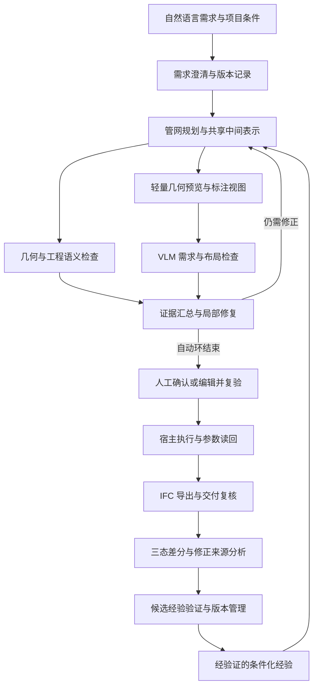

# 硕士学位论文开题报告：市政管网研究方案初稿

版本日期：2026-10-16。

本文依据本轮讨论形成：主验证场景确定为市政管网；研究方案先行，随后依据方案核查代码。本文是研究内容初稿，尚未套用学校正式模板。系统实现状态、实验结果、规范条文和完整文献综述均须分别核实，不能将下文的拟研究内容当作已完成成果。原有《开题报告.md》和 Word 文件保留。

## 一、拟定题目与研究边界

推荐题目：**《面向市政管网的生成式 BIM 智能体协同建模与经验自进化方法研究》**。

英文工作题目：**Collaborative Modeling and Experience-Based Self-Evolution of Generative BIM Agents for Municipal Pipe Networks**。

研究范围固定为 Agent 方法与系统：基座 LLM/VLM 权重保持不变，不开展训练、微调或参数学习。“协同建模”明确指 Agent 编排下的视觉检查、确定性约束、人工反馈与 MCP 执行协同，不预先承诺多智能体并发带来收益。“经验自进化”的更新对象为外部经验、规划策略和受控配置。当前不将“物理”扩展为结构力学或水力学仿真，不使用“形式化证明”描述普通几何检查。

研究内容分为三块：Agent 编排与探索—执行底座、领域约束与人机反馈驱动的协同建模、修正轨迹驱动的跨任务经验自进化。拟提出两项主要方法创新，并以自研 Agent 系统作为一项完整的系统贡献。领域规则是协同建模的依据，视觉/人工反馈和 MCP 执行属于当前任务闭环；从这些过程提取经验并改善后续任务，才构成经验自进化。

主场景为市政管网。建议先将重力流排水管网作为主要实验子类，管段、节点/检查井、支管接入和障碍物作为基本对象。其他既有管线可作为带类型和尺寸的避让对象。上述子类划分为方案建议，用户目前确认的是市政管网主场景。

初期覆盖：空间布置、管段连接、坡度和流向、几何净距、构件类型、属性及 IFC 关系。暂不以复杂曲面管件、完整给排水水力设计、多专业全量规范审查为必要前提。具体规则的限值应来自经核实的规范版本、项目条件或明确标注的实验规则。

## 二、选题依据与研究意义

### 2.1 研究背景

市政管网 BIM 建模需要同时处理设计意图、空间位置、构件关系及工程约束。自然语言便于表达任务目标，但通常不能直接给出完整、无歧义且满足全部约束的参数集合。大语言模型能够辅助需求理解、任务规划和工具调用，生成结果仍需经过可执行性、几何关系和工程语义检查。

面向此类任务，系统需解决三类问题。第一，频繁在完整 BIM 宿主中生成和修改模型可能带来较大的执行与状态恢复开销，其实际大小需要测量。第二，仅凭渲染图难以确认小尺度净距、坡度和连接误差，仅凭确定性规则又难以覆盖全部自然语言布局意图。第三，任务执行轨迹往往以原始日志保留，缺少从修正过程提取可复用经验并检验其跨任务有效性的机制。

本研究拟通过共享结构化表示连接轻量探索和 BIM 执行，引入视觉反馈与工程约束验证形成闭环，并将经验证的修正记录转化为带适用条件的外部经验。

### 2.2 研究意义

理论与方法方面，研究不同性质的反馈如何在同一建模状态上协同，探索满足硬约束前提下的局部修正策略，以及修正经验在不同任务之间的迁移边界。

工程方面，构建从需求澄清、管网规划、轻量校验、宿主建模到 IFC 交付的可追溯流程，为降低无效宿主执行和人工重复修正提供方法依据。

评价方面，建立同时关注生成质量、约束满足、执行成本和经验有效性的实验协议。可运行的代码、校验规则和任务定义应构成支撑研究结论的证据。

## 三、国内外研究现状与拟补充工作

### 3.1 自然语言驱动 BIM 与程序化建模

应系统梳理自然语言到建模代码、结构化场景和 BIM 工具调用的研究，比较其任务范围、构件表示、反馈机制、目标宿主和交付要求。Text2BIM 的原始摘要明确介绍了多智能体、领域规则检查、检查反馈指导下的迭代改进，以及 Vectorworks 原型[2]。因此，原有材料中将其概括为 Blender 单向生成的说法需要纠正；不能用自行简化的实现代替原系统而沿用其名称。本课题的增量需要在具体约束、反馈修复策略、探索—执行一致性和跨任务经验机制上进一步建立。

### 3.2 多模态反馈与确定性约束验证

相关研究需要区分四种能力：观察渲染结果、定位缺陷、提出可执行修改、验证修改后的状态。研究重点在于将视觉发现的问题转换为带对象 ID 和修改范围的结构化建议，并使用几何及语义检查约束其应用过程。普通阈值检查、数值求解与逻辑证明应使用各自准确的名称。

### 3.3 智能体反思与经验学习

Reflexion 已研究通过语言反馈和反思记忆改善后续尝试，并明确采用不更新模型权重的方式[1]。因此，“记录轨迹、让模型反思、将经验放回上下文”不能单独作为本课题的原创主张。

ExpeL 已研究从训练任务经验中以自然语言抽取知识，并在推理时调用经验与见解[3]；Voyager 则包含可执行技能库、技能检索以及使用环境反馈改进程序的机制[4]。本轮已核验这些原始摘要，完整方法仍需阅读全文比较。

本课题拟进一步关注：如何区分自动约束修正、用户需求变更和偏好调整；如何为经验限定适用条件；如何在经验引入后再次验证；如何通过未参与经验积累的任务检验收益。现阶段不据此宣布研究空白或唯一性。

### 3.4 初步研究定位

研究定位为市政管网领域中的约束驱动生成与经验复用。原创性需通过更完整的文献检索确认，当前优先形成以下可检验的问题，而不是依赖工具名称或架构规模主张创新。

## 四、研究目标与关键研究问题

### 4.1 总体目标

构建可追溯的市政管网生成式 BIM 智能体方法：将自然语言需求转化为包含几何、拓扑和工程属性的结构化状态，在轻量环境中完成可审计的约束检查与局部修正，经宿主执行和导出复核后交付模型，并积累可复用的修正经验。

### 4.2 关键研究问题

- RQ1：共享表示与轻量探索能否在保持最终质量的条件下降低重型宿主的调用次数、执行耗时和失败恢复开销？
- RQ2：视觉反馈与确定性约束检查如何提供互补证据，并在局部修复中减少新增违规和需求偏离？
- RQ3：带修正来源、适用条件及验证准入的经验记忆，能否比原始历史检索和普通反思摘要更稳定地改善新任务的初稿质量及完成成本？

## 五、研究内容

### 5.1 共享管网表示与探索—执行一致性

定义统一管网中间表示，至少包含：稳定构件 ID、管段与节点类型、空间坐标、坐标系和单位、外径/内径等明确区分的尺寸字段、连接关系、流向、约束引用、修改锁及版本信息。

由同一状态生成轻量预览和宿主操作计划。轻量预览可以由 OpenSCAD 提供；Vectorworks MCP 可作为目标宿主执行接口。具体工具是实现选择，方法贡献来自表示、检查与反馈机制。

宿主执行后，读取可获得的构件属性和几何信息，并在 IFC 导出后复核关键参数和关系。轻量环境通过校验不等于目标宿主必然保真：几何解释、单位、构件类型和连接语义的差异必须检测。对于未支持的构件映射，应显式报告，不能用视觉近似替代语义正确性。

### 5.2 视觉—几何—工程语义协同校验与局部修复

视觉输入包含需求摘要、结构化状态、带 ID 与坐标标注的多视图，以及已发现的硬约束问题。管网场景优先提供平面图、关键纵断面和适当的三维视图；必要时增加局部剖切，避免埋地或重叠构件不可见。

VLM 输出结构化问题记录：问题类型、相关构件 ID、观察依据、建议修改、置信度或不确定性标记。置信度只是待校准的辅助信号，不能替代实际验证。

确定性检查器执行几何与语义规则，返回违规对象、实际值、阈值、适用规则及规则来源。修复策略优先处理影响范围较小且有明确证据的问题，随后重验受影响约束和全局不变量。

保留满足已验证条件的状态，并根据最大预算、无有效改善、不可解约束或人工接管条件停止。不同误差量纲不同，初期采用硬约束门禁与分层排序，不将未经归一化的误差简单加权后宣称最优。

### 5.3 基于修正来源与三态差分的经验演进

在每一版稳定需求下，定义三类关键状态：

- S0：针对该版需求生成的初稿，尚未进入反馈修正循环。
- S1：自动反馈与修正结束后的状态，同时记录通过、部分通过或失败等实际结局。
- S2：人工确认并准备执行的状态；若存在人工编辑，记录编辑操作和原因。没有编辑时可令 S2=S1，并标注无人工修正。人工编辑后的硬约束仍须重验，确认结果再交给 MCP 执行。

所有自动中间状态和工具反馈仍须保留。宿主执行、参数读回、导出与最终验收结果作为关联 S2 的执行证据记录，不能用“已人工确认”替代交付检查。如果执行反馈引发新的参数修订，记录新版本和其修正链。若用户改变任务需求，建立新的需求版本与状态链，不能将变更直接归为模型错误。

结构化差分提取增加、删除、移动、尺寸修改和连接变更等操作，再与修正触发原因及验证结果关联。将经验组织为：适用条件、失败模式、处理策略、可执行约束、证据来源、有效性统计、版本与停用条件。

工作流记忆保存可复用的步骤策略；约束记忆保存经审查的条件规则；个体偏好仅在相应用户或项目范围内使用。项目规范阈值从受控规则库获取，不允许经验摘要任意改写。

候选经验经规则一致性检查和保留用例验证后进入正式记忆。在后续任务中按条件检索、注入相关经验，再对生成结果执行原有验证。连续失败、冲突或负迁移的经验可降权、停用或回滚。

## 六、核心约束的数学定义草案

### 6.1 管段净距

设管段中心线段为 li、lj，外半径为 ri、rj。对采用胶囊体保守包络近似的直管段，定义：

\[
c_{ij}=d_{\mathrm{seg}}(l_i,l_j)-(r_i+r_j),\qquad
v_{ij}=\max(0,c_{ij}^{\mathrm{req}}-c_{ij}).
\]

其中，c_req 是经确认的适用净距要求。该量是近似包络下的净距违反程度，单位为长度；它不等于精确实体穿透体积。曲管、管件和精细交接可采用实际几何检查，需报告容差和数值失败情况。

预期接入的管段需要限定允许相交的连接区域及连接类型，不能因共享节点就豁免两构件在其他位置的全部碰撞检查。水平净距、垂直净距和实体最短距离也应按具体规则分别计算。

### 6.2 坡度与流向

对重力流直管段，水平投影长度 Lh>0，按规定的上游到下游方向定义：

\[
i_e=\frac{z_{\mathrm{up}}-z_{\mathrm{down}}}{L_{h,e}}.
\]

z 的物理含义须在数据模型中统一，例如内底标高；若数据使用中心线标高，必须正确转换。坡度约束的上下界及适用条件由具体规则确定。竖向构件不能直接使用该公式。坡度通过仅说明该项几何条件通过，不能推出流量或水力能力满足要求。

### 6.3 连接连续性

对任务指定的连接关系，使用端点与接入点的位置差、连接类型以及网络可达性共同检查。几何接近不能单独证明拓扑连接，图连通也不能单独证明几何接触。检查井内允许的标高差和接入关系必须由对象语义解释，不能统一要求所有连接点完全重合。

### 6.4 语义与交付

检查构件类型、必要属性、系统归属、流向或连接关系，以及导出后可获得的对应信息。IFC 文件可解析、Schema 验证、项目自定义规则和工程规范检查分别报告。结论仅限于实际执行的检查集合。

## 七、技术路线

宿主或交付复核失败时，错误应关联至当前状态和规则证据，再决定回到探索修复、重试执行或请求人工处理。

## 八、拟创新点与贡献边界

### 创新点一：领域约束与人机反馈驱动的双态协同建模方法

拟研究 Agent 如何在共享管网状态上组织领域知识、视觉检查、几何与工程语义验证、人工修改与目标宿主执行。轻量探索阶段将问题定位到构件和关系，进行受范围限制的局部修正；人工确认及修改锁约束后续自动操作；MCP 将确认的状态映射为宿主构件，并通过参数读回与交付复核检查一致性。

该创新覆盖一个任务内“规划—预览—校验—自动/人工修正—精细建模—复核”的闭环。MCP 是执行接口；能否生成精细、正确的构件取决于工具契约、参数映射和宿主实现，不能由协议本身保证。

需证明：与单纯视觉反馈、单纯规则反馈及无局部限制的修正相比，能够改善哪些指标、在何种任务上有效、增加多少检查成本。单独使用 AABB、OpenSCAD、VLM 或 IFC 工具不构成该创新的充分依据。

### 创新点二：基于三态修正轨迹的 Agent 经验自进化方法

拟研究如何利用创新点一产生的自动修正、人工纠错及执行反馈，从三态轨迹中分离候选经验，将其表达为带适用条件的工作流策略和约束经验，经过验证后复用于新任务，并处理冲突和负迁移。来源区分和验证准入是这一方法的组成机制，而非独立于 Agent 自进化的研究目标。

需证明：与不使用记忆、直接检索历史日志、普通反思摘要相比，经验的正确性、适用性或任务表现存在可重复的提升。三态快照和 Diff 是数据基础，不能直接等同于因果识别。

### 系统贡献：可规划、可校验、可干预、可追溯的 openBIMAgent

自研 Agent 的规划与任务状态、模型接口、领域包、共享中间表示、MCP 接入、版本管理、前端修改锁、失败补偿和导出复核共同形成系统贡献。Agent 底座需要在研究内容、系统实现和整体实验中完整呈现；其工程工作量与两项方法创新分别陈述。探索—执行的成本收益及一致性可以单独分析；只有存在明确的新调度或一致性机制并有对照证据时，才进一步主张独立的架构创新。

## 九、实验设计

### 9.1 任务集合

以管段数量、节点数量、障碍密度、约束组合及需求完整度组织难度。覆盖基础生成、已知障碍避让、节点接入、局部修改和相互冲突的要求。另建人工注入错误的样本，评价检查器与修复器。

经验积累任务与保留评测任务分离。独立评测集不得反向用于经验筛选。经验准入可使用另行划分的验证用例，并计入相应成本。使用多个任务顺序和重复运行报告波动；任务数量由先导实验的方差、预算和可检测效果确定。

### 9.2 实验一：外部对比——openBIMAgent、OpenCode 与 Text2BIM

目的：检验整体 Agent 方法在同类管网任务上的质量、完成率和成本。

| 对比系统 | 实施定义 |
|---|---|
| openBIMAgent | 本文完整方法，记忆版本固定，使用预先积累且不含测试任务的经验；另可报告冷启动结果 |
| 原始通用 OpenCode Agent | 固定公开版本，以公开支持的方式配置同一基座模型与可比的建模工具，保留其原有规划与交互能力，不注入本文新增闭环和经验模块 |
| 原版 Text2BIM | 尽量按原始公开实现复现，保留原有规则反馈与迭代；需先评估其对管网任务的适用性和所需工具适配 |

“Text2BIM 风格单向生成”若保留，应命名为“Text2BIM-inspired 一次生成参考基线”，明确是自行简化的参考实现，不能称为原版。若原版不支持所选管网任务，先确定公开且透明的共同任务子集或适配协议；不可不说明适配就得出整体优劣结论。必要的适配工作量与限制本身应报告。

受控比较固定需求、基座模型版本、允许的建模动作和输出要求，并规定模型调用、时间与修复预算。对原方法不能保持等价设置的部分逐项披露。记录所有模型和验证成本。自动化主比较不提供人工设计修改；另在人在环子实验中给各系统相同的人工介入预算和操作条件。

主要指标：无本次修复的初稿可行率、预算内成功率、净距/坡度/连接与交付通过率、总耗时和模型消耗。探索—执行节省的宿主次数、耗时及一致性作为本组成本分析；需要时增加小规模直接宿主探索诊断。

### 9.3 实验二：内部消融——Full 与三个关闭项

目的：在同一 Agent 底座上检验各机制的实际贡献。主对照固定为以下四个版本，不做组合的笛卡尔积。

| 版本 | 关闭内容 | 保留内容 |
|---|---|---|
| Full Model | 无 | 完整自动反馈、领域护栏和经验调用 |
| w/o 视觉—几何双重校验 | 关闭探索阶段的视觉反馈与碰撞、净距、坡度、连接等几何反馈修正 | Agent 编排、领域知识输入、语义/工具契约门禁及 MCP 执行 |
| w/o 领域知识护栏 | 移除领域规划先验、检索知识和领域语义门禁；系统级格式、类型及执行安全契约保持一致 | 基于相同实验规则的几何检查、视觉反馈及经验机制 |
| w/o Trace 经验自进化 | 停止经验提取、更新、检索与注入 | 保留相同的日志、状态快照和本次任务内自动修复，保留人工接口 |

三者关闭项需要在实现中明确边界。几何检查器使用规则库中的数值；知识护栏消融保留这些检查数值，以免同时删除另一项机制。关闭经验时仍保留留痕，否则无法区分可观测性与经验复用效果。

实验中的最终评价器对所有版本保持一致，且不把错误结果反馈给已关闭相应反馈的版本。关闭研究机制不等于移除共同的执行安全条件。预先检查 Full 使用的经验是否复制了被消融模块的能力；对相关经验做一致的能力屏蔽，并披露屏蔽规则，避免知识通过记忆绕过消融。

主消融固定记忆快照，避免各版本边测试边积累不同经验。若要分别主张视觉与几何的贡献，在本组内补充“仅关闭视觉”“仅关闭几何”两个诊断版本。若要主张差分提取与来源过滤优于一般记忆，在本组内做原始历史或普通反思摘要的小规模对照。按具体贡献选择必要诊断，不扩成新的主实验组。

### 9.4 指标口径

| 指标 | 定义与用途 |
|---|---|
| 初稿可行率 | S0 在无本次反馈修正条件下满足指定硬约束的任务比例 |
| 预算内成功率 | 在固定时间、调用或修复预算内完成指定任务及交付检查的比例 |
| 净距违规 | 违规对数、违反程度及必要时的精细碰撞结果，明确规则和单位 |
| 坡度与连接通过率 | 分别报告适用管段、指定连接和网络要求的通过情况 |
| 需求满足率 | 硬需求依规则判定；未能自动判断的语义需求用独立评价协议 |
| 宿主与交付一致性 | 关键几何参数、构件类型和关系在映射前后的差异 |
| 执行成本 | 全部模型 token、调用次数、渲染/校验时间、宿主时间、恢复时间及经验维护成本 |
| 人工负担 | 在独立人工参与子实验中统计主动操作数、时间和修改原因 |
| 经验质量 | 有效、误触发、冲突、负迁移及停用情况 |

不将“经过多轮自动修复后成功”混称为“初稿一次通过”。如果沿用 Pass@1，须定义一次样本是否允许内部修复，并同时报告无修复的初稿指标。

VLM 自评不能作为其自身修复成效的唯一裁判。硬约束优先采用独立检查；剩余需求由固定评价器或盲评协议评估，并报告评价不确定性。

### 9.5 实验三：多模型切换与 30～50 个任务的经验演进

目的：检验固定基座模型时经验积累的变化，并比较该机制在不同模型配置上的适用性。计划设置 30～50 个经验积累任务；它们不等于独立评测集，也不保证足以证明统计结论。

候选配置覆盖用户提出的 Claude、DeepSeek、Gemini、Flash，实验时逐一记录确切模型标识、版本、服务提供方、采样参数和日期；系列名与型号/档位名不能混用。纯文本配置的看图环节如需独立 VLM，可固定 VLM 检查器，明确“切换的是规划/生成模型”；若整套模型配置同时变化，则只能作端到端配置比较。

本组按三个子步骤执行：

1. 固定一个主模型，设置经验开启与经验关闭两条任务流，在相同的 30～50 个任务顺序下运行；到预定检查点冻结记忆，在独立保留任务上评测。使用多个任务顺序或重复运行估计波动。
2. 在其他模型上比较同一组固定经验与无经验的表现；预算允许时重复完整积累过程。跨模型复用收益与各模型独立积累收益分别报告。不要在同一条曲线中途换模型后将变化归因于经验。
3. 在固定、具有代表性的任务子集上开展真实人工参与实验，记录每任务人工主动编辑、交互轮次和时间。各检查点使用一致的介入规则；必要时平衡任务顺序，以免把操作者熟练程度误认为 Agent 进步。

主要曲线：初稿可行率/明确定义的 Pass@1、预算内成功率、自动修复轮次、人工编辑次数与时间、总成本及失败任务比例。修复轮次同时报告失败/预算耗尽任务，防止因系统更早放弃而出现虚假的轮次下降。

研究假设为随经验积累出现总体改善及可能的平台期，展示区间和失败案例。不得预设或加工成单调曲线；若使用平滑曲线，须同时保留原始点并说明方法。“收敛”只有在指标和观察长度支持时使用，否则称为“经验演进趋势”。无人工参与的主实验仅能报告自动指标，不能生成真实人工修改次数。

## 十、可行性、风险与应对

现有开题稿记载了 Agent Core、SCAD 预览、MCP、领域包和轨迹等工程基础。这些是既有文档的陈述，实际状态须后续读取代码、运行样例并核实，不在此重复认定为完成。

主要研究风险包括：轻量表示与宿主几何不一致、视觉反馈误判、复杂规则超出实验范围、错误经验跨任务传播及真实人工数据不足。拟分别通过宿主读回和导出复核、独立硬约束检查、收窄任务范围、经验准入与停用、分离自动实验和人工实验处理。

若经验机制无法获得稳定收益，应保留负结果并分析适用范围；核心校验与修复方法可形成相对独立的研究贡献。不能为追求预期曲线改变评测集或删除不利任务。

## 十一、实施安排与预期成果

按依赖关系实施，具体日期与学校进度另行对齐：

1. 完成文献核验、选题边界、开题正文和大小论文结构。
2. 将每项拟研究机制映射至真实代码，形成已有、可扩展、缺失及不需要的清单。
3. 完成共享表示、确定性检查和最小端到端实验。
4. 加入视觉局部修复，开展受控消融并冻结评价协议。
5. 加入三态记录、来源标注和经验准入，开展保留任务实验。
6. 完成宿主与 IFC 复核、人工子实验、结果分析和论文实证章节。

预期成果包括：一套市政管网生成与验证方法；一套来源可追溯的条件化经验机制；可复现任务、规则和评测流程；openBIMAgent 原型与关键实现；学位论文与研究论文。任何定量提升均以实际实验为准。

## 十二、已核验参考与待完成综述

[1] Shinn N, et al. Reflexion: Language Agents with Verbal Reinforcement Learning. [原始论文页面](https://arxiv.org/abs/2303.11366)。本轮已读取原始摘要，用于确认不更新模型权重、语言反馈与反思记忆这一已有研究方向。

[2] Du C, Esser S, Nousias S, Borrmann A. Text2BIM: Generating Building Models Using a Large Language Model-based Multi-Agent Framework. [原始论文页面](https://arxiv.org/abs/2408.08054)。本轮已读取原始摘要，用于核对多智能体、规则反馈、迭代改进和 Vectorworks 原型。

[3] Zhao A, et al. ExpeL: LLM Agents Are Experiential Learners. [原始论文页面](https://arxiv.org/abs/2308.10144)。本轮已读取原始摘要。

[4] Wang G, et al. Voyager: An Open-Ended Embodied Agent with Large Language Models. [原始论文页面](https://arxiv.org/abs/2305.16291)。本轮已读取原始摘要。

正式参考文献表需继续阅读全文，补充多模态建模反馈、管网约束检查、IFC 交付与近期研究，并按学校要求补齐版本、发表信息和引用。当前列表不代表完整查新结论。
