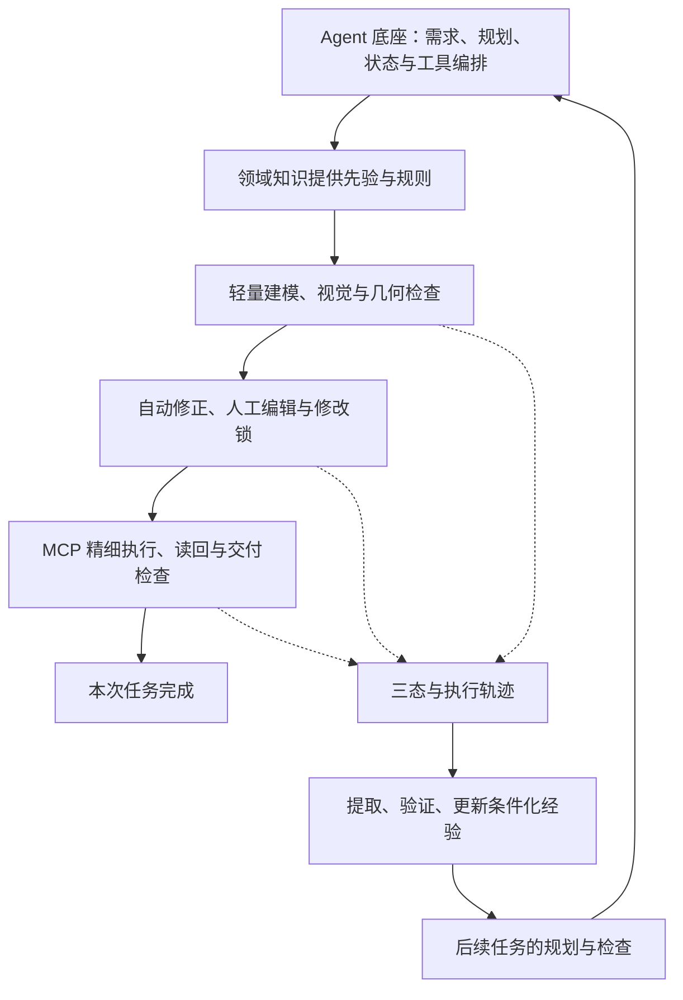

# 机制解释与大小论文结构：市政管网方向

日期：2026-10-16。与《13_开题报告_市政管网研究方案初稿.md》配套。

当前确定：以市政管网为主场景，先收敛研究内容与文章结构，再依据创新机制核查和修改代码。本文给出机制解释、拟定标题及逐章提纲；结果性正文等待真实实验数据。

## 一、视觉纠错到底做什么

### 1.1 对“把图片给 LLM，让它自己改”的准确理解

基本理解成立，但模型需要具备图像理解能力，并获得原始需求、构件标识和可编辑参数。普通纯文本模型不能直接理解像素内容。VLM 是具有视觉输入能力的模型；在系统中，它可以负责看图发现问题，也可以同时提出修改建议。

完整流程为：需求与当前结构化模型 → 渲染标注视图 → VLM 指出问题并提出修改 → 修改作用于结构化状态 → 几何与语义检查 → 重新渲染与复核。

图片是观察材料，模型参数是修改对象。模型不应通过修改截图使结果看上去正确。是否使用同一个多模态模型承担生成和检查角色，是实现与实验选择；角色分离本身不代表评价已经独立。

### 1.2 市政管网例子

用户要求一条主排水管连接多个检查井，支管接入主干，并绕开指定障碍区域。首稿可能出现支管接错方向、某个节点遗漏、布局偏离指定走廊，以及逆坡和净距不足。

VLM 可以根据平面图和纵断面指出“支管 P7 似乎接入了错误节点”“东侧要求保留的通道被占用”。为了可操作，反馈应关联 P7、目标节点及对应需求，而非仅写“布局不好”。对于具体净距、坡度和隐蔽碰撞，必须计算。

可用视图由任务决定：平面图检查路径和布局，纵断面检查高程变化，局部剖切检查交叉位置，三维视图辅助理解整体关系。无标注的四张图不一定比两张针对性图更有效。

### 1.3 数学检查与 VLM 如何配合

假设一项演示任务明确指定某直管段长度为 50m，水平投影也为 50m，上游内底标高 10.00m，下游应比上游低 0.20m。这里的数值只用于说明流程，不代表规范推荐。

如果初稿把下游写成 10.20m，按上游到下游计算坡度为 -0.004，存在方向错误。检查器可直接计算并定位；看图模型是否能看清该错误不应决定是否通过。候选修复为 9.80m 后，还需检查下游节点接入条件、与其他管线的净距和覆盖条件。修正一个数值不等于整个系统已可行。

同样，VLM 建议把管段向一侧移动，可能改善视觉布局却碰到其他设施。其建议需要通过确定性检查，失败时保留原状态或寻找其他候选。

因此，“自动消除 90% 缺陷”目前应改写为“研究视觉反馈与确定性约束协同修复的效果”。实际自动修复率需要有缺陷类别、样本数量、预算和独立判据，不能把剩余工作固定归为人工审美。

## 二、自进化到底改了什么

### 2.1 Agent 经验能力的三个层次

| 层次 | 实际动作 | 能支持的表述 |
|---|---|---|
| 留痕 | 保存对话、工具调用、截图和结果 | 可追溯、可复盘 |
| 经验检索 | 下一次取出相似任务或历史错误 | 基于历史经验辅助生成 |
| 经验演进 | 提取、筛选、验证和更新条件化策略，并用于新任务 | 外部记忆或策略演进 |

本项目聚焦第三层，前两层为其基础。基座 LLM/VLM 权重保持不变，训练与微调不属于研究内容。改变的是 Agent 在任务中调用的知识、步骤策略和部分受控配置。最终可能体现为提示词上下文变化，也可能体现为规划模板或已验证规则被调用。

### 2.2 提示词怎样变化

不建议每次完成任务都重写整份系统提示词。可以保持核心角色、工具契约和工程规范来源稳定，在当前任务中插入少量相关经验，例如：

> 当前任务包含重力流支管接入和障碍避让。相关历史失败表明，仅修改一处标高可能使下游管段产生逆坡。调整高程后应复验受影响的上下游路径，并检查接入点和交叉净距。

这段内容需要来自可追溯的失败与修复证据，并有相应适用条件。新任务没有该条件时，不应强制加入。

若经验涉及可执行检查器，则应走受控的规则或代码变更流程：生成候选、验证适用性与回归结果、版本化发布。运行中的记忆更新不能任意改写规范阈值或未经验证地永久修改验证器。

### 2.3 三态快照如何工作

S0 保存首稿，S1 保存自动修正结束状态，S2 保存人工确认的拟执行状态；人工编辑后仍需重验硬约束，再由 MCP 执行。宿主执行、导出和最终验收另记关联证据，执行失败引发的参数修订需记录新版本。三态应对应同一需求版本，并以共享结构化表示为主要差分对象。

自动差分可以记录：P4 下游内底标高由 10.20 改为 9.80；触发规则是坡度方向；相关上下游段已复验；最终检查结果如何。代码文本 Diff 可以辅助追踪，但变量改名和格式变化不应被当成设计修正。

人工差分则至少需要区分：

- 原要求已写明避开西侧施工区，系统漏掉，用户将管段移开：需求执行纠错。
- 用户后来新增“西侧禁止开挖”：需求变更，应建立新需求版本。
- 用户说“这个项目我更喜欢走东侧”：项目或个人偏好，不能推广成普遍管网规则。

仅凭坐标从西侧改到东侧，模型无法可靠判断上述原因。因此，界面应记录修改原因，或采用明确规则并保留不确定标签。没有证据的变动可留在历史中，不必强行蒸馏为全局经验。

### 2.4 一个完整经验条目包含什么

1. 适用条件：任务类别、构件关系、约束类型及必要的项目条件。
2. 失败模式：什么条件下出现何种违规。
3. 修正策略：应该先检查什么、修改哪些对象、哪些对象需连带复验。
4. 证据：任务与需求版本、前后状态、触发规则及验证结果。
5. 作用范围：通用方法、特定工程条件、项目配置或用户偏好。
6. 维护信息：有效案例、误触发案例、冲突、版本及停用原因。

工作流记忆回答“怎样安排步骤”；约束经验回答“在什么条件下必须注意哪类失败”。不需要把每个项目的全部尺寸搬进全局提示词。

### 2.5 如何证明“进化”发生

记录了更多日志、记忆库变大和模型自述更有经验，都不能证明实际收益。需要冻结同一基座模型，在独立任务上比较：不使用经验、原始历史检索、普通反思摘要与完整机制。

重点看首稿硬约束通过率、固定预算内完成率、修复成本及负迁移。连续任务期间在不同记忆版本检查点运行固定保留评测集，才能减少后期任务更容易这一混杂因素。经验筛选使用独立验证集，最终评测集不能参与筛选。

改善可以波动；应报告均值、区间、失败案例和成本，不预设单调曲线。没有人工参与的实验不能声称减少了真实人工编辑次数。

## 三、创新点够不够

### 3.1 初步判断

作为硕士课题，若完成受控的市政管网生成、验证闭环、经验机制与可信实验，研究组织和实现工作量有足够展开空间。是否达到学位要求由导师和学校评审决定。

对于研究论文，现阶段可以提出贡献假设，尚不能仅根据方案宣称原创性和发表把握。Reflexion 已有反思记忆；ExpeL 已有跨任务经验提取；Voyager 已有技能积累与检索。Text2BIM 原始摘要已明确包含规则检查、迭代改进和 Vectorworks 原型。对应来源见开题初稿参考文献。

因此需要证明更具体的增量：

| 拟贡献 | 核心内容 | 必要的对照证据 |
|---|---|---|
| 领域约束与人机反馈驱动的双态协同建模 | Agent 编排领域知识、视觉与几何检查、人工修正锁及 MCP 精细执行，完成当前任务闭环与交付复核 | Full 与关闭双重校验/领域护栏；比较违规、需求偏移、完成率和成本 |
| 三态修正轨迹驱动的 Agent 经验自进化 | 利用当前任务产生的修正证据区分来源，验证条件化经验并用于后续任务 | Full 与关闭经验；必要时增加原始历史/普通反思诊断；独立任务趋势 |
| 自研 Agent 系统与评测 | 规划状态、模型接口、领域包、探索—执行、前端交互、MCP 和轨迹共同形成完整系统 | OpenCode/Text2BIM 外部对比、成本与宿主一致性分析 |

两项主要创新足以形成清晰主线。不要为了“凑创新点”将前端、网关、MCP、日志和多模型切换各自包装成独立算法贡献。

### 3.2 Agent、领域、反馈与自进化的关系

Agent 是整个方法的执行主体，系统底座需要作为独立研究内容和系统贡献完整展开。“领域”提供规则和先验；视觉检查与人工编辑为当前任务提供反馈；MCP 将确认状态落实为精细宿主构件；Trace 为上述过程保留证据；经验提取与检索再改变后续任务的规划和行为。

创新点一回答“这次怎样完成并验证建模”，覆盖领域约束、视觉/人工协同及 MCP 执行；创新点二回答“下次怎样利用本次经验少犯同类错误”。两者共享轨迹，但具有不同目标与独立评价。仅人工改好一次模型或成功调用一次 MCP，尚不能说明发生了跨任务自进化。

当前按“两个方法创新＋一个系统贡献、三块研究内容”组织。若底座的调度或状态一致性确有独立机制与实验证据，再评估是否单列架构创新。毕业判断以问题、方法、可复现证据及适用边界为依据，不能仅按创新点数量或代码量判断；学校和专业的正式要求仍需单独核对。

图中的本次任务闭环对应创新点一；轨迹到经验再到后续任务对应创新点二；Agent 底座组织两者并形成系统贡献。

### 3.3 需要从材料中删除或收紧的表述

- “100% 消灭幻觉”“杜绝宿主崩溃”“所有规范合规”：改为明确检查集合、覆盖范围和实测结果。
- “类 Lean 形式化证明”：目前使用“确定性约束校验”；真正采用证明系统后再调整术语。
- “三态 Diff 因果蒸馏”：目前使用“基于修正来源的差分经验提取”；因果论断需要额外识别假设与实验设计。
- “双态等于 TCC 事务”：探索与执行可以借鉴阶段化思想；幂等、补偿和原子回滚需分别说明实际保证。
- “原版 Text2BIM 为单向生成”：根据原始论文修正。
- “SCI/顶会是同一验收目标”：先选择目标研究社区和论文类型，再根据对应证据要求组织文章。

## 四、硕士论文建议结构

### 4.1 推荐标题

**《面向市政管网的生成式 BIM 智能体协同建模与经验自进化方法研究》**。

“协同建模”指 Agent 编排视觉、几何约束、人工反馈与宿主执行；“自进化”指外部经验与规划策略更新。标题和正文均围绕 Agent，不开展基座模型训练。

### 4.2 七章结构及各章要回答的问题

**第1章 绪论**

1.1 市政管网 BIM 建模背景与需求；1.2 自然语言建模、反馈修正和智能体经验学习研究现状；1.3 研究问题与挑战；1.4 研究内容与贡献；1.5 论文组织。

目的：说明为什么需要本研究，以及与已有规则检查、反思记忆方法的具体区别。

**第2章 相关基础与问题形式化**

2.1 管网对象、几何和拓扑关系；2.2 LLM/VLM 工具调用与反馈；2.3 管网任务与共享表示；2.4 约束、修复预算和目标定义；2.5 经验与评价协议；2.6 本章小结。

目的：统一单位、坐标、标高、对象关系和成功判据。避免将本章写成工具安装教程。

**第3章 领域约束与人机反馈驱动的双态协同建模方法**

3.1 总体框架与探索—执行划分；3.2 标注多视图与视觉问题定位；3.3 净距、连接、坡度等确定性检查；3.4 反馈证据整合与局部修复策略；3.5 修改锁、冲突处理和终止条件；3.6 宿主映射及一致性复核；3.7 本章小结。

主要产物：约束定义、反馈结构、修复算法伪代码、总体图与典型案例。小规模机制实验可放本章，系统性比较集中至第6章。

**第4章 基于三态修正轨迹的 Agent 经验自进化方法**

4.1 状态、需求版本与修正来源；4.2 结构化差分与失败归类；4.3 需求变更及偏好过滤；4.4 工作流与约束经验表示；4.5 候选经验验证、检索和注入；4.6 冲突、停用与负迁移控制；4.7 本章小结。

主要产物：经验数据模型、提取与准入算法、经验生命周期图及正反案例。明确区分同任务自动修正和跨任务经验复用。

**第5章 openBIMAgent 系统设计与实现**

5.1 功能需求与总体架构；5.2 编排状态和模型接口；5.3 轻量预览与宿主工具适配；5.4 校验和修复服务；5.5 三态轨迹与经验存储；5.6 前端交互与修改来源记录；5.7 IFC 交付和关键实现；5.8 本章小结。

主要产物：真实模块映射、接口与状态图、关键实现取舍。只写支撑研究方法的工程部分，不贴大段源代码。

**第6章 实验设计与结果分析**

6.1 任务集合、划分、模型和预算；6.2 校验器及评价指标；6.3 实验一：openBIMAgent/OpenCode/Text2BIM 外部对比（含成本与宿主一致性）；6.4 实验二：Full 与关闭双重校验、领域护栏、经验演进的内部消融（必要诊断放本组）；6.5 实验三：多模型与 30～50 个任务经验演进（含真实人工参与子实验）；6.6 失败分析、统计不确定性与有效性威胁；6.7 本章小结。

主要产物：任务统计、对比表、消融表、质量—成本图、经验检查点曲线、失败分类和可复现配置。

**第7章 总结与展望**

7.1 研究工作与实际结论；7.2 贡献及其适用范围；7.3 局限；7.4 未来研究。

目的：总结已被证据支持的结论，并说明未覆盖的管网类型、复杂构件或水力设计问题。

## 五、研究小论文建议结构

### 5.1 推荐工作标题

**openBIMAgent: Constraint-Guided Generation and Experience Reuse for Municipal Pipe-Network BIM**

中文对应：**《openBIMAgent：面向市政管网 BIM 的约束引导生成与经验复用》**。

标题聚焦研究对象与两个机制。是否加入“Neuro-Symbolic”取决于最终方法是否清晰展示神经决策与符号约束的交互；是否加入“Self-Evolution”取决于是否完成跨任务有效性的实证。不能仅为增强措辞而堆叠术语。

### 5.2 文章结构

**1. Introduction**：市政管网受约束建模问题、现有方法的具体不足、三个研究问题、两项方法贡献与系统/评测贡献。贡献表述使用完成时的前提是相应方法和实验已完成。

**2. Related Work**：自然语言 BIM；多模态与规则反馈；经验学习及记忆。逐项比较可复现机制，避免泛称其他工作缺少校验。

**3. Problem Formulation**：需求、管网表示、规则集合、预算、成功条件、三态状态及经验更新对象。给出最必要的数学定义。

**4. Method**：4.1 共享表示和探索—执行；4.2 证据驱动的多维验证与局部修复；4.3 来源区分和条件化经验；4.4 经验验证与检索；4.5 宿主和交付复核。给出总体图和两个核心算法。

**5. Experiments**：5.1 数据与设置；5.2 外部对比：openBIMAgent/OpenCode/Text2BIM；5.3 内部消融：Full 与三个关闭项；5.4 多模型与 30～50 个任务经验演进（含人工子实验）；5.5 失败与成本分析。保留三组主实验，诊断分析按所属机制并入各组。

**6. Discussion and Limitations**：失败类型、经验负迁移、规则覆盖、视觉误判、简化几何与宿主差异、人工数据局限。

**7. Conclusion**：只概括实际方法与实验支持的结论。

### 5.3 建议准备的图表

- 图1：共享表示、协同修复、宿主执行和经验更新的总体流程。
- 图2：一例管网从 S0 到 S1、S2 的变化，以及对应约束证据。
- 图3：经验在多个检查点上的独立任务表现与区间。
- 表1：任务集合与约束覆盖。
- 表2：外部基线的质量与总成本。
- 表3：视觉、几何、语义和局部修复的消融。
- 表4：无记忆、原始历史、普通反思与完整经验的比较。
- 表5：宿主/导出一致性与失败分类；可视篇幅放附录。

如果经验实验暂时不能支撑独立贡献，小论文应收窄为约束驱动修复，不将未验证的经验机制强塞入标题。大论文仍可如实呈现经验方法、实验与局限。

## 六、文稿与后续代码核查的对应原则

当前不依据旧文档认定模块已经实现。下一阶段先做真实代码映射，然后确定改动；按以下顺序验收研究机制：

| 文稿机制 | 后续要查证的代码能力 | 最小证据 |
|---|---|---|
| 共享管网表示 | 单位、标高、ID、类型、关系与版本能否共同表达 | 同一状态可生成预览和宿主操作计划 |
| 确定性校验 | 净距、坡度、连接与语义规则是否真实执行 | 已知正确/错误样本及可定位的结果 |
| 视觉局部修复 | 图片、构件 ID、需求和可执行 patch 是否打通 | 修复能重验，失败可恢复 |
| 宿主一致性 | 是否能读回关键参数并复核导出模型 | 映射前后差异与未支持项报告 |
| 三态与来源 | 是否记录 S0/S1/S2、需求版本和修改原因 | 可还原的一次自动与人工修正 |
| 条件化经验 | 是否提取、验证、检索、更新和停用 | 一条经验能改变后续任务行为且可追溯 |
| 实验协议 | 是否支持同预算基线、消融与独立任务 | 可复跑的配置、结果与成本记录 |

先完成研究范围与文稿结构定稿，再形成逐文件修改清单。论文目录不能替代功能验收，工程功能清单也不能替代研究贡献。
